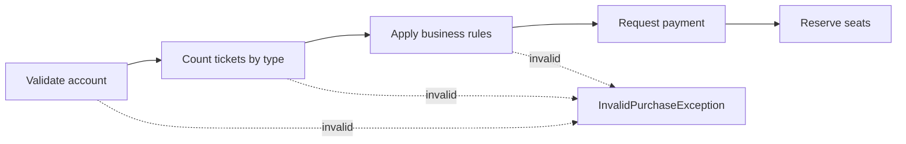

# Cinema Tickets Coding Test

**Java 21** · **Spring Boot 3.5** · **Maven 3.9+**

An implementation of the DWP cinema tickets exercise in Java 21.

`TicketServiceImpl` validates a ticket purchase request against the business rules, calculates
the amount to pay and the number of seats to reserve, and then calls the `TicketPaymentService`
and the `SeatReservationService`. Invalid requests are rejected with an `InvalidPurchaseException`
before either service is called.

> **Note**
> The brief asks for a `TicketService` implementation only. A small Spring Boot REST API has
> been added on top so the service can also be exercised over HTTP. The service has no
> dependency on Spring; the `config` package wires it up and the `web` package maps HTTP
> requests to it. `TicketServiceImpl` and its tests are the core of the submission.

## Contents

- [Getting started](#getting-started)
- [Design](#design)
- [Business rules](#business-rules)
- [Assumptions](#assumptions)
- [Testing](#testing)
- [Project structure](#project-structure)

## Getting started

### Prerequisites

- JDK 21
- Maven 3.9 or later

### Build and run

```shell
mvn clean test           # run the test suite
mvn spring-boot:run      # start the API on http://localhost:8080
```

### API usage

`POST /cinema/bookings`

```shell
curl.exe -s -X POST http://localhost:8080/cinema/bookings -H "Content-Type: application/json" -d '{\"accountId\":250,\"ticketRequests\":[{\"type\":\"ADULT\",\"ticketCount\":2}]}'
```

| Outcome | Status | Body |
| --- | --- | --- |
| Booking accepted | `201 Created` | `{"accountId":250}` |
| Business rule broken or invalid input | `400 Bad Request` | problem detail |
| Unsupported HTTP method | `405 Method Not Allowed` | problem detail |

Example error response:

```json
{
  "type": "about:blank",
  "title": "Bad Request",
  "status": 400,
  "detail": "Child or Infant tickets require an Adult ticket.",
  "instance": "/cinema/bookings"
}
```

The response does not include the total cost or the seat count, because
`TicketService.purchaseTickets` returns `void` and the interface cannot be changed.

## Design

### Purchase flow



1. **Validate the account.** The account ID must be present and greater than zero.
2. **Count tickets by type.** Each request must be non-null, have a type and have a
   non-negative count. Counts for the same type are summed.
3. **Apply the business rules.** See [Business rules](#business-rules).
4. **Pay and reserve.** The total cost and seat count are calculated, payment is requested,
   and the seats are then reserved.

All validation completes before either third-party service is called, so a purchase can never
be partly processed.

### Design decisions

- **Overflow protection.** Ticket counts are summed as `long`. Very large counts therefore
  cannot overflow an `int` and bypass the 25-ticket limit. This is covered by a test.
- **Pricing in the service.** Prices are held in a single `TICKET_PRICES` map in
  `TicketServiceImpl`. Pricing is business logic, so it is kept out of the `TicketTypeRequest`
  value object, and a price change is a one-line edit.
- **Named error messages.** Each error message is a constant, and the unit tests assert against
  those constants, so messages and tests cannot drift apart.
- **Constraints respected.** The `TicketService` interface and the `thirdparty` packages are
  unchanged. `TicketTypeRequest` has been made immutable: the class and its fields are `final`.

## Business rules

| Ticket type | Price | Seat allocated |
| --- | ---: | :---: |
| Adult | £25 | Yes |
| Child | £15 | Yes |
| Infant | £0 | No |

| Rule | Implementation |
| --- | --- |
| Multiple tickets per purchase | Any number of requests is accepted; requests of the same type are summed |
| Maximum of 25 tickets per purchase | The total across all types, including infants, must not exceed 25 |
| Infants do not pay and are not allocated a seat | Infant price is £0; seats = adults + children |
| Child and Infant tickets require an Adult ticket | Rejected when the adult count is zero |
| Account IDs greater than zero are valid | Null, zero and negative IDs are rejected |

## Assumptions

Where the brief is open to interpretation, the following decisions were made:

| # | Assumption | Rationale |
| :---: | --- | --- |
| 1 | Infants count towards the 25-ticket limit | An infant still receives a ticket, even though it is free |
| 2 | Infants may not outnumber adults | Each infant sits on an adult's lap, and each adult has one lap |
| 3 | There is no limit on children per adult | The brief does not specify one |
| 4 | A purchase must contain at least one ticket | A zero count for one type is allowed if other tickets are bought |
| 5 | Negative ticket counts are rejected | Even when the overall total would still be positive |
| 6 | Null requests, or requests without a type, are rejected | Skipping them would hide a client error |
| 7 | Payment is requested before seats are reserved | Both services are assumed always to succeed, so no rollback is needed |
| 8 | Unknown ticket types and malformed JSON return `400` | Handled by Spring's default error handling |

## Testing

| Test class | Scope | Tests |
| --- | --- | :---: |
| `TicketServiceImplTest` | Unit tests for the service, with the third-party services mocked | 25 |
| `TicketControllerTest` | HTTP tests through the real service, with only the third-party services mocked | 19 |

The unit tests cover:

- every business rule, and the boundaries around each one (25 and 26 tickets; infants equal to
  and greater than adults)
- the exact amount charged and the number of seats reserved
- payment being requested before seats are reserved
- no payment or reservation taking place when a request is rejected

The HTTP tests check that valid bookings return `201` and that each kind of invalid request
returns `400` with the correct error detail.

## Project structure

```
src/main/java
├── thirdparty/                        # Provided; unchanged
│   ├── paymentgateway/
│   └── seatbooking/
└── uk/gov/dwp/uc/pairtest/
    ├── TicketService.java             # Provided interface; unchanged
    ├── TicketServiceImpl.java         # Business logic
    ├── CinemaTicketsApplication.java  # Spring Boot entry point
    ├── config/                        # Bean configuration
    ├── domain/                        # TicketTypeRequest (immutable)
    ├── exception/                     # InvalidPurchaseException
    └── web/                           # REST controller, request/response models, error handler
```
